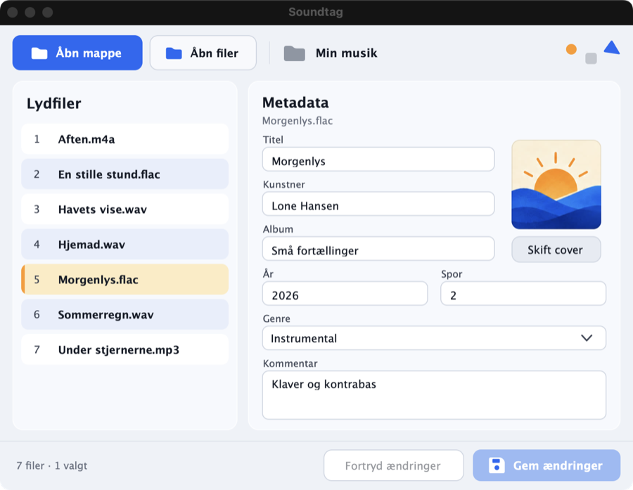

# Soundtag

En lille, hurtig editor til metadata (tags) og albumcover i lydfiler – skrevet i C++ med [JUCE](https://juce.com) og [TagLib](https://taglib.org).



## Funktioner

- **Åbn mappe** – alle lydfiler i mappen vises i listen *Lydfiler* (eller vælg enkelte filer med **Åbn filer**, eller træk filer/mapper ind i vinduet).
- Klik på en fil for at redigere **titel, kunstner, album, år, spor, genre og kommentar**.
- **Albumcover**: klik på coveret eller *Skift cover* for at vælge et billede (JPG/PNG/GIF/BMP). Højreklik for at fjerne coveret. Store billeder skaleres automatisk ned.
- **Gem ændringer** (Ctrl/Cmd+S) skriver direkte i filen; **Fortryd ændringer** henter de gemte værdier igen.
- Advarer om ikke-gemte ændringer, når du skifter fil, åbner en ny mappe eller lukker appen.
- Understøttede formater: MP3, FLAC, WAV, AIFF, M4A/MP4/AAC, OGG, Opus, WMA, APE, WavPack, MPC, DSF.
- Lille vindue (720 × 530) og et program på få MB uden afhængigheder.

## Installation

Hent den nyeste udgave under [Releases](https://github.com/shenphenchoedron-hue/Soundtag/releases).

| System | Fil | Installation |
|---|---|---|
| **Windows** 10/11 (64-bit) | `Soundtag-*-Windows-Setup.exe` | Dobbeltklik og følg guiden. Opretter genvej i Start-menuen og på skrivebordet. |
| **macOS** 11+ (Apple Silicon & Intel) | `Soundtag-*-macOS.dmg` | Åbn DMG-filen og træk **Soundtag** over i **Programmer**. Første gang: højreklik → *Åbn* (appen er ikke notariseret). |
| **Ubuntu** 22.04 / 24.04+ | `soundtag_*_ubuntu22.04_amd64.deb` | `sudo apt install ./soundtag_*_ubuntu22.04_amd64.deb` |
| **Debian** 12+ | `soundtag_*_debian12_amd64.deb` | `sudo apt install ./soundtag_*_debian12_amd64.deb` |

## Byg selv

Kræver CMake ≥ 3.22 og en C++17-compiler. JUCE og TagLib hentes automatisk.

```sh
cmake -B build -DCMAKE_BUILD_TYPE=Release
cmake --build build --parallel
cd build && cpack          # laver DMG / NSIS-installer / .deb
```

Linux kræver desuden: `libfreetype6-dev libfontconfig1-dev libx11-dev libxcomposite-dev libxcursor-dev libxext-dev libxinerama-dev libxrandr-dev libxrender-dev`.

Test af læsning/skrivning af tags: `cmake -B build -DSOUNDTAG_BUILD_TESTS=ON`, byg og kør `SoundtagTests <lydfiler…>` (filerne kopieres først, originalerne røres ikke).

## Licens

GPL-3.0 – se [LICENSE](LICENSE).
